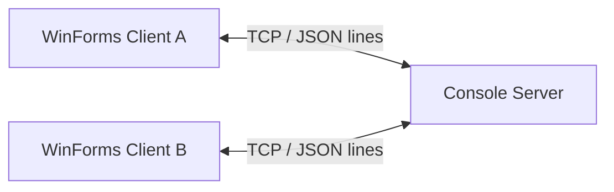

# LAN Chat — C# TCP Client/Server

Ứng dụng chat nội bộ để thực hành TCP sockets và giao diện Windows Forms. Server chuyển tiếp tin nhắn JSON giữa các client; hỗ trợ chat chung, chat riêng và danh sách người dùng online.

**Công nghệ:** C# · .NET 10 · WinForms · TCP · JSON.



## Chạy thử trên Windows

Cần Windows và .NET 10 SDK. Clone repository, mở terminal tại thư mục gốc:

```powershell
git clone https://github.com/DragonWind-non/AppChatClone.git
cd AppChatClone
dotnet build frmClient.slnx -c Release
dotnet run --project Server/Server.csproj
```

Nhập cổng hoặc Enter để dùng `8888`. Trong terminal khác:

```powershell
dotnet run --project RegisterClient/RegisterClient.csproj
```

Nhập IP server, cổng và username chưa được sử dụng. Khi thử trên một máy, IP là `127.0.0.1`; mở thêm client để kiểm tra chat chung và chat riêng.

Khi thử trên hai máy cùng LAN, dùng IPv4 của máy chạy server và cho phép đúng cổng TCP trong Windows Firewall trên mạng Private. Không tắt toàn bộ firewall. Máy client cũng cần mã nguồn và .NET SDK vì màn hình đăng nhập khởi chạy project MainClient bằng `dotnet run`.

## Cấu trúc

| Thành phần | Trách nhiệm |
|---|---|
| `Server/` | TCP listener, quản lý username và chuyển tiếp tin nhắn |
| `RegisterClient/` | Nhập IP/cổng/username, khởi chạy client chính |
| `frmClient/` | Giao diện chat và kết nối TCP |
| `tests/test_protocol.py` | Kiểm thử tích hợp qua TCP thật |

Mỗi dòng trên kết nối là một đối tượng JSON. Client gửi `JOIN` trước khi chat; server phát `USER_LIST` khi danh sách online thay đổi. Tin nhắn `PUBLIC` gửi cho cả phòng, `PRIVATE` chuyển cho username đích.

## Kiểm chứng

Bộ kiểm thử dùng Python 3 và thư viện chuẩn, không cần cài package:

```powershell
dotnet build Server/Server.csproj -c Release
python tests/test_protocol.py
```

Năm ca kiểm tra server thật: username trùng không thay thế kết nối gốc; không chat trước JOIN; không đổi danh tính bằng JOIN lần hai; server gắn tên người gửi đúng kết nối cho cả chat chung và riêng.

## Giới hạn

- Đây là bài thực hành trong LAN tin cậy: chưa có mật khẩu, xác thực tài khoản hoặc TLS.
- Username gắn với kết nối chỉ ngăn giả danh trong cùng phiên; không chứng minh danh tính ngoài đời.
- Chưa có giới hạn kích thước dòng JSON, giới hạn kết nối, reconnect hoặc kiểm thử tải/gửi đồng thời.
- Chưa đóng gói bộ cài độc lập. Các ca TCP không thay thế kiểm tra giao diện WinForms và hai máy LAN thật.
- Build hiện còn các cảnh báo nullable; cần xử lý trước khi coi là bản phát hành hoàn chỉnh.

Cache Visual Studio, đầu ra build và cấu hình người dùng được bỏ khỏi phiên bản hiện tại. Lịch sử commit cũ vẫn có thể chứa những tệp đó; việc dọn phiên bản mới không xóa lịch sử.
